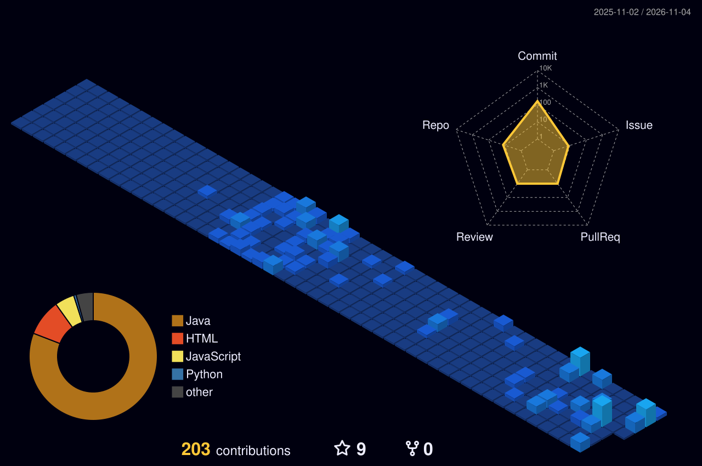

  <!-- TYPEWRITER ANIMADO -->
  

    

  <!-- BADGES DE STATUS 3D -->
  
  
  

 

<!-- ELEMENTO 3D EM ROTAÇÃO CONTÍNUA (RODA DIRETO NA TELA SEM LINK) -->

  

 

<!-- GRÁFICO ISOMÉTRICO 3D DE COMMITS -->

  <h3>🏙️ Gráfico Isométrico 3D de Commits</h3>
  

### 🚀 Sobre Mim
- 🎓 **Formação:** Engenharia de Software @ UMC | Desenvolvimento Web @ Anhanguera
- 🌐 **Foco Profissional:** Administração de **Redes de Computadores**, **Segurança da Informação** e Desenvolvimento de APIs RESTful escaláveis em **Java 21 / Spring Boot**.
- 💼 **Experiência:** Estagiário de Suporte em TI @ TV Diário (Afiliada Globo) — Helpdesk/Service Desk, gerenciamento de acessos via **Active Directory (AD)** e manutenção de infraestrutura.
- 📌 **Projeto em Destaque:** Construção do **INVEST+**, sistema backend em Java para automação e rebalanceamento de carteiras de investimento.

### 💻 Tecnologias & Ferramentas (Exibição 3D Direta)

  <!-- ÍCONES 3D (APENAS EXIBIÇÃO DIRETA, SEM REDIRECIONAMENTO) -->
  
  
  
  
  
  
  
    

  
  
  
  
  
  

    

  <!-- EMBLEMAS 3D PLASTIC -->
  
  
  
  
  
  

### 📡 Redes, Infraestrutura & Especialidades
- 🌐 **Redes de Computadores & Infraestrutura:** Configuração e monitoramento de redes locais (LAN), protocolos de conectividade, diagnósticos de conexões e manutenção preventiva/corretiva.
- 🔑 **Administração de Acessos:** Gerenciamento de contas, permissões, grupos e diretivas corporativas via **Active Directory (AD)**.
- 🔒 **Segurança da Informação:** Autenticação e Autorização (JWT, 2FA), algoritmos de hashing (Argon2id), criptografia e políticas de segurança / LGPD.
- ☕ **Desenvolvimento Backend:** Java 21/25, Spring Boot (MVC & WebFlux), Hibernate/JPA, Maven, APIs RESTful e SOLID.
- 🤖 **Internet das Coisas (IoT):** Desenvolvimento de sistemas de monitoramento com ESP32, MicroPython e protocolo MQTT.

<!-- INTERAÇÃO NATIVA DE EXPANDIR AO CLICAR -->

  
<b>🛠️ Ver Setup & Ambiente de Desenvolvimento (Clique para expandir)</b>

   
  
  - 💻 **Sistema Operacional:** Windows 11 + WSL2 (Ubuntu & Alpine Linux)
  - 🖥️ **Monitor:** Monitor Gaming AOC via DisplayPort
  - 🐳 **Ambiente Containerizado:** Docker Desktop & Redis
  - 🛠️ **Ferramentas:** Visual Studio Code, Git CLI, RedisInsight & Postman

### 📬 Conecte-se Comigo

  
  
  

